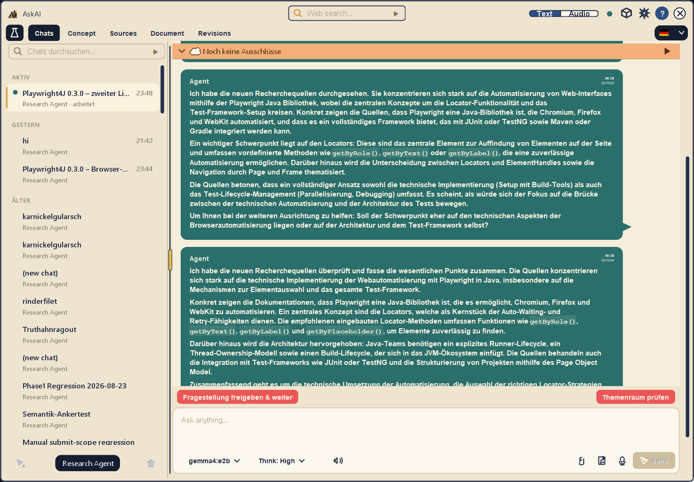
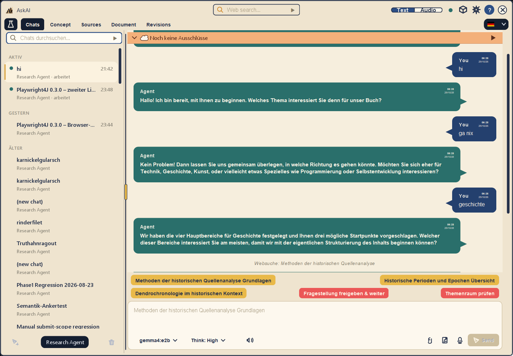
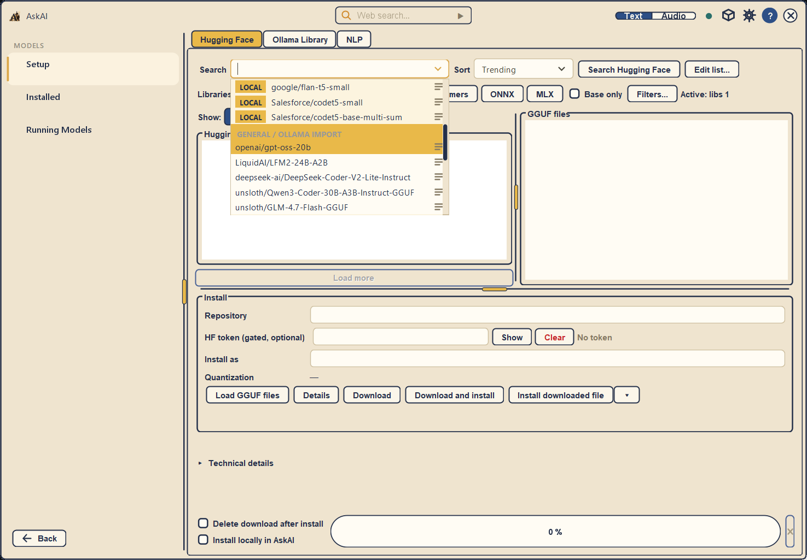
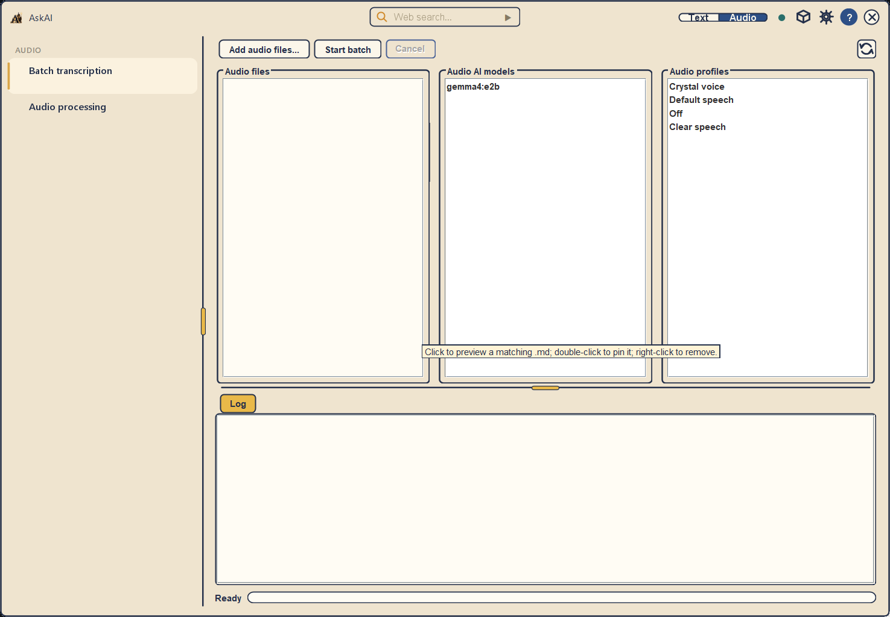
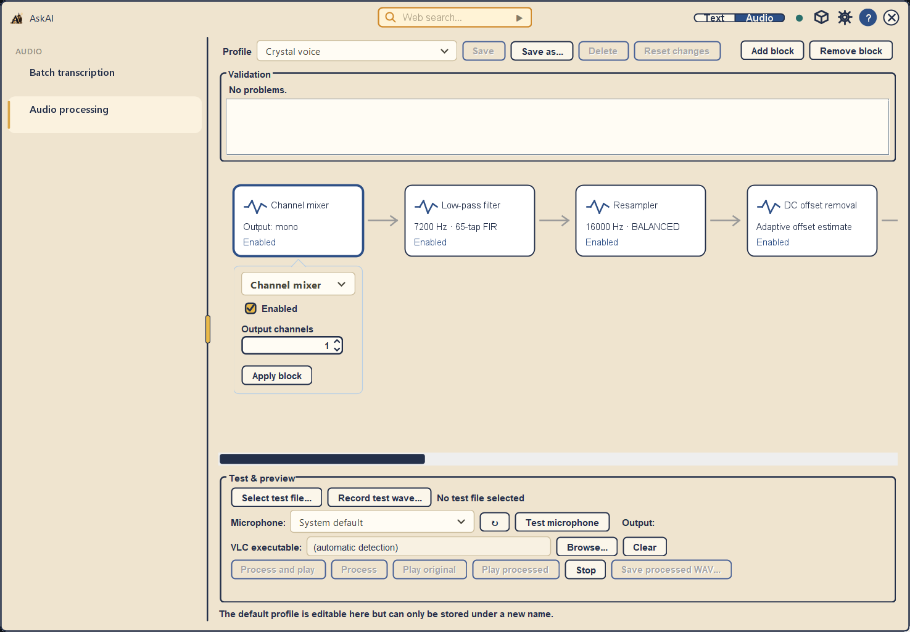
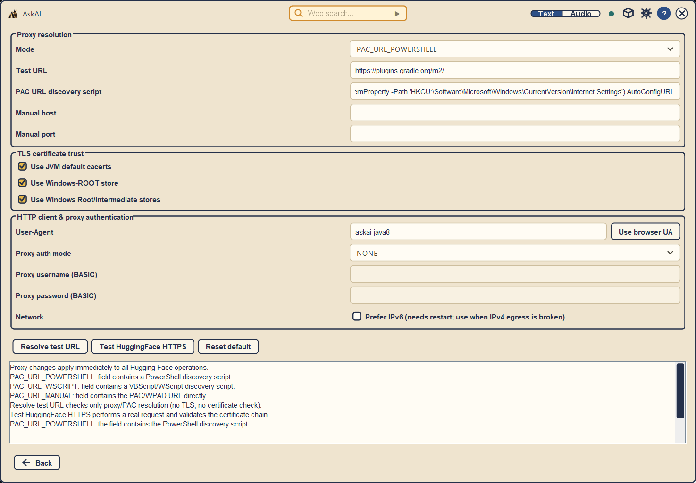
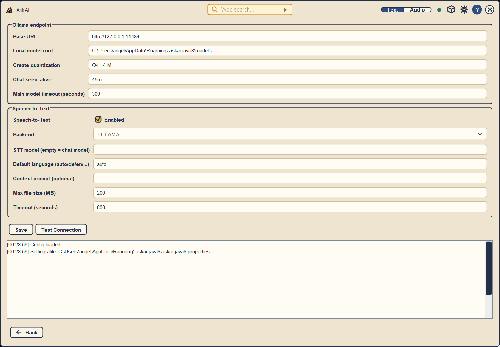

<p align="center">
  
</p>

# AskAI

AskAI is a Java 8 Swing desktop client for local AI. It talks to an Ollama server and to its own
local model runtime, and you can extend it with PF4J agent plugins. The main plugin is the
**Research Agent**. It turns a question into a researched document backed by sources, in four phases:
**Concept → Sources → Outline → Document** (the outline is worked on in a drawer of the Document
tab). A **Revisions** view shows how the project got there.

## Screenshots

<table>
  <tr>
    <td width="50%"><br><sub>Research Agent chat with the source summary</sub></td>
    <td width="50%"><br><sub>Concept conversation with search-suggestion tags and the "out of scope" sky</sub></td>
  </tr>
  <tr>
    <td width="50%"><br><sub>Models drawer: Hugging Face setup</sub></td>
    <td width="50%"><br><sub>Audio drawer: batch transcription</sub></td>
  </tr>
  <tr>
    <td width="50%"><br><sub>Audio processing (DSP) pipeline editor</sub></td>
    <td width="50%"><br><sub>Network settings: proxy resolution, TLS trust, HTTP client</sub></td>
  </tr>
  <tr>
    <td width="50%"><br><sub>Ollama endpoint and speech-to-text settings</sub></td>
    <td width="50%"></td>
  </tr>
</table>

## Features

### Chat

- Chat with any installed Ollama model. Responses stream in as they are generated.
- Markdown rendering in assistant bubbles, including Mermaid diagrams.
- Attachments in the composer. Chat history is saved and searchable.
- Speech-to-text dictation through the Ollama server, with a selectable audio-processing profile.
- Read-aloud speech output through Piper voices.
- Three chat modes, picked in the footer of the chat list:
  - **Yapping** chats with the model directly.
  - **Questing** runs an installed agent plugin.
  - **Partying** is a decentralized group chat over the LAN using JGroups
    (see [doc/partying-group-chat.md](doc/partying-group-chat.md)).

### Research Agent (plugin)

- **Concept:** you and the agent work out the question and its scope in a conversation. The concept
  includes a mindmap of the topics to research.
- **Semantic scope fence:** exclusions go on a blacklist, and that blacklist acts as a hard filter on
  what research collects. A scope probe tells you whether candidate terms are in scope, out of scope,
  or on the boundary.
- **Web research:** a browser sidecar drives a locally installed Chrome or Edge through Playwright4J.
  It handles search result pages, link following, consent and captcha handling, and content-readiness
  checks.
- **Sources:**
  - Each page moves through a lifecycle (visited → candidate → accepted) and is deduplicated by
    canonical URL and content hash.
  - You can also import sources manually from HTML, plain text or PDF (Apache PDFBox).
  - A read-only **Passages** view shows the semantic passages extracted from each source.
- **Document:** there is one Markdown working document (`document.md`). It has a chapter view with
  clickable source badges, and its outline sits in a drawer.
- **Revisions:** shows the research state machine and how the project changed over time.
- **Control:** the user owns every phase transition. You can steer the agent with slash commands
  (`/status`, `/approve`, `/request-changes`, `/pause`, `/resume`, `/cancel`, `/open`) or the action
  tags in the chat.
- **Runtime:** the agent runs as a separate process. It talks ACP to AskAI and MCP to the
  research-control and browser endpoints.

### Models

- Browse the Ollama library and pull model tags onto the configured Ollama server.
- Search Hugging Face for GGUF models, download files and import them into Ollama.
- Manage installed and running models (`/api/show`, `/api/ps`).
- A local model runtime: a Java 21 sidecar with an Ollama-compatible HTTP API, for locally installed
  models. Its first capability is cross-encoder reranking via win-directml-java.
- A management tab for NLP models (OpenNLP), used by the knowledge pipeline.

### Audio

- **Batch transcription:** transcribe many recordings with several audio models and audio profiles in
  one run. Each result goes into a Markdown file next to the recording. Supported formats are WAV, MP3,
  M4A/AAC, OGG and FLAC.
- **Audio processing:** a Java2D editor for DSP profiles (IIR filters, spectral blocks, resampler and
  channel blocks). Dictation and batch transcription share these profiles.

### ChatGPT connector and MCP

- **Bot control:** each research session exposes an MCP endpoint with three tools: `run_command`,
  `session_state` and `chat_history`
  (see [docs/research-bot-control.md](docs/research-bot-control.md)).
- **ChatGPT connector:** AskAI can register itself as a ChatGPT connector. It serves its own public MCP
  endpoint and OAuth 2.0 server (authorization code + PKCE, refresh tokens). TLS is terminated at a
  reverse proxy. The connector is off by default
  (see [docs/research-chatgpt-connector.md](docs/research-chatgpt-connector.md)).

### Network

- Proxy resolution: manual, PAC/WPAD URL, or PAC discovery via a PowerShell or WScript script.
- TLS trust from the JVM cacerts and the Windows certificate stores.
- Proxy authentication, a custom User-Agent, and a "Prefer IPv6" option.

### Appearance

- Two themes you can switch at runtime under **Settings → Appearance**: **Arcane Knowledge**
  (parchment, navy and gold) and **Classic Comic**.
- All Swing controls come from the `comic-controls` design system (shared palettes, Java2D painters,
  comic controls).

## Requirements

- **Java 8** to run AskAI. Every module except the two sidecars is compiled for Java 8.
- **Java 21** for the sidecar processes `browser-mcp-server-java21` (Playwright4J) and
  `local-model-runtime-sidecar-java21` (win-directml-java). Gradle finds Java 21 as a toolchain. If no
  Java 21 toolchain is available, `run` starts without the local model runtime.
- **An Ollama server** for chat, dictation and model management.
- **Chrome or Edge** installed locally for browser research. The sidecar uses the browser channel
  mechanism (`chrome` / `msedge`) and never downloads a browser
  (see [docs/browser-mcp.md](docs/browser-mcp.md)).

## Build and run

The Gradle wrapper uses Gradle 7.6.4. On Windows, run these commands from Git Bash.

```bash
# Runnable Java 8 fat jar -> askai-app/build/libs/askai-java8-0.1.0.jar
./gradlew :askai-app:fatJar

# Run AskAI (stages the local model runtime when a Java 21 toolchain is available)
./gradlew :askai-app:run

# Run AskAI with the Research Agent plugin, the research runtime and the local model runtime
./gradlew :askai-app:runWithDevPlugins
```

Individual distributions:

| Task | Output |
|---|---|
| `:askai-app:researchRuntimeDist` | `build/research-runtime/` (research agent jar, browser sidecar jar, `lib/`) |
| `:askai-app:localRuntimeDist` | `build/local-runtime/` (local model runtime sidecar jar, `lib/`) |
| `:research-agent-ui-plugin:installDevPlugin` | installs the research plugin into `build/dev-plugins/` |
| `:askai-app:verifyFatJarExclusions` | fails if research plugin classes leaked into the fat jar |

To set the version, pass `-PreleaseVersion=<version>` (the default is `0.1.0`). `chatgpt-build.sh`
builds the fat jar with a project-local Gradle home.

The research plugin and both sidecars are deliberately **not** part of the fat jar. The plugin is loaded
by PF4J from a plugin directory, and the sidecars run as separate processes.

MP3, M4A/AAC, OGG and FLAC decoding depends on Java Sound service providers (`javasound-*`). The
`mergeServiceFiles` task merges their `META-INF/services` descriptors into the fat jar. The first build
must run online once to fill the Gradle cache.

### Configuration

Settings are stored in `%APPDATA%\.askai-java8\askai-java8.properties` (`~/.askai-java8/` if
`APPDATA` is not set).

## Project structure

| Module | Purpose |
|---|---|
| `askai-app` | The Swing application: chat, models, audio, settings, plugin host wiring; builds the fat jar |
| `ollama4j-java8` | Small Java 8 Ollama client based on `HttpURLConnection` |
| `comic-controls` | Dependency-free Swing design system: palettes, themes, Java2D painters, controls |
| `audio-dsp` | Audio capture and DSP pipeline (IIR filters via iirj, FFT/STFT blocks) |
| `audio-openal` | Optional OpenAL Soft playback backend (LWJGL); natives are installed as an opt-in add-on |
| `group-chat-api` | Group-chat domain (rooms, participants, bot election, history) for Partying |
| `group-chat-jgroups` | JGroups transport for the group chat |
| `agent-workspace-api` | Framework-free workspace and host-service contracts shared by host and plugins |
| `agent-plugin-pf4j-api` | The PF4J extension point bridge |
| `agent-plugin-host` | PF4J plugin host: catalog, compatibility checks, workspace lifecycle |
| `agent-model-runtime-api` | Neutral model-runtime contracts (reranker endpoint descriptor, configuration codec) |
| `research-agent-ui-plugin` | The Research Agent PF4J plugin (UI, state machine, sources, scope, document) |
| `research-agent-runtime` | External research agent process (ACP to AskAI, MCP to research-control/browser) |
| `research-domain` | Research domain core: business objects, ids, revisions, approval baselines |
| `research-knowledge-pipeline` | Research method pipeline: sentences → passages → topic clusters → concept/outline proposals |
| `research-knowledge-processing` | Restart-safe processing queue and worker that drive captures through the pipeline |
| `research-text-opennlp` | Apache OpenNLP sentence-segmentation adapter |
| `research-knowledge-lucene` | Apache Lucene index adapter for the semantic knowledge index |
| `browser-api` | Generic, framework-free browser port |
| `browser-search-analysis` | Mechanical analysis of search result pages (regions, result blocks, candidates) |
| `browser-static-http` | Static HTTP browser backend (`HttpURLConnection` + jsoup, no JavaScript) |
| `browser-mcp-server-java21` | Java 21 browser MCP sidecar based on Playwright4J (`web_*` tools over Solon MCP) |
| `local-model-runtime-sidecar-java21` | Java 21 local model runtime sidecar (Ollama-compatible API, DirectML reranking) |
| `mcp-runtime-api` | Generic MCP runtime contracts |
| `mcp-solon-runtime` | Solon-based streamable-HTTP MCP server behind the runtime port |
| `mcp-marketplace` | MCP marketplace search/registry/import browser (saves configurations only; not wired into the app) |
| `acp-client-api` | Neutral ACP client contracts |
| `acp-solon-client` | ACP adapter (acp-sdk/Reactor) implementing the client port |
| `acp-demo-agent` | Demo ACP agent process used by the adapter round-trip test |
| `web-search-providers` | Isolated async web-search provider clients (Brave, Bright Data, DataForSEO); not productively switched on |

## Documentation

- [docs/research-agent.md](docs/research-agent.md): Research Agent overview and slash commands
- [docs/research-mvp.md](docs/research-mvp.md): research MVP architecture and acceptance
- [docs/research-artifacts.md](docs/research-artifacts.md): research artifacts
- [docs/research-state-machine.md](docs/research-state-machine.md): research state machine
- [docs/research-source-lifecycle.md](docs/research-source-lifecycle.md): source lifecycle and deduplication
- [docs/research-search-architecture.md](docs/research-search-architecture.md): search architecture
- [docs/research-agent-runtime.md](docs/research-agent-runtime.md): external research agent runtime
- [docs/research-control-mcp.md](docs/research-control-mcp.md): research-control MCP endpoint
- [docs/research-bot-control.md](docs/research-bot-control.md): headless bot control
- [docs/research-chatgpt-connector.md](docs/research-chatgpt-connector.md): ChatGPT connector (German)
- [docs/browser-mcp.md](docs/browser-mcp.md): browser MCP sidecar
- [docs/agent-plugin-development.md](docs/agent-plugin-development.md): writing chat agent plugins
- [docs/plugin-lifecycle.md](docs/plugin-lifecycle.md): plugin lifecycle
- [docs/mcp-runtime.md](docs/mcp-runtime.md), [docs/mcp-marketplace.md](docs/mcp-marketplace.md), [docs/acp-client.md](docs/acp-client.md): MCP and ACP infrastructure
- [docs/theme-system-spec-v2.md](docs/theme-system-spec-v2.md): theme system specification (German)
- [mvp-roadmap.md](mvp-roadmap.md): MVP roadmap (German)

## License

[MIT](LICENSE) © 2026 AresStack
